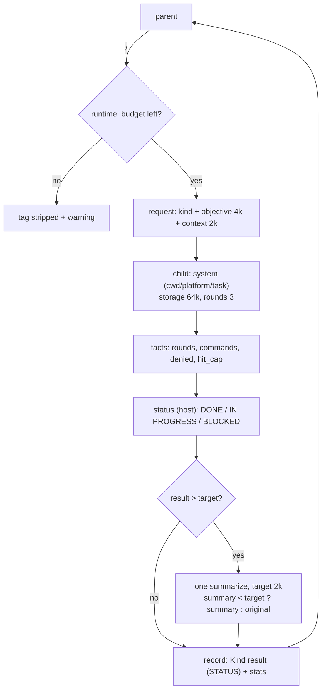

# Delegation flow (parent → child)

> Status: planned (task 054). This page describes the designed flow; the shipped
> code is the pre-054 delegation. The plan lives in
> `../../tasks/task_054_delegation-limits.md`.

The parent model asks for a sub-tell with `<DELEGATE>` (research, read-only) or
`<SUBTASK>` (build, normal approval). The host runs one child, gets a bounded
record back, and continues its own loop. The child never talks to the user and
never recurses.

## Terms

**Briefing = system + context.** The objective is the message; the turns are the
child's own work.

| Part | Built by | Cap | Stored in the child | Purpose |
|---|---|---|---|---|
| **System** (briefing) | core `child_system_prompt` + host (`cwd`, `platform`, `taskId`) | fixed, short | no | identity, rules (read-only, batching, data ≠ instruction) and environment |
| **Context** (briefing) | host, per delegation (parent's last answer, sanitized) | 2 KiB | yes, counts in 64k | background for the follow-up rounds |
| **Objective** | parent, sanitized | 4 KiB | yes, counts in 64k | the task itself |
| **Turns** | the child (commands, outputs, answers) | the rest of 64k | yes | the work |

The model is stateless: every round re-sends the whole conversation, so the
briefing is seen in every round. Only its storage differs — the system is not
persisted, the context is.

## Flow



1. The parent answer contains at most one tag; a second tag is stripped and
   reported (never dropped in silence). A tag inside a literal ` thinking` block
   or a fenced block is inert.
2. The runtime checks the budget (2 delegations per invocation; `0` when the
   chain has fewer than 2 rounds). No budget left: tag stripped, warning
   printed (stderr + log on the CLI, event on the Web), no child.
3. The host builds the request: `{ kind, objective (4k, sanitized), context }`.
   The context is the parent's **current** answer, sanitized
   (`strip_think_tags` → `strip_run_tags` → `strip_delegation_tags` → `redact`)
   and capped at 2k; an empty context omits the block.
4. The child runs with the system prompt (rules + `cwd`/`platform`/`task`), the
   objective and the context. Its storage is bounded at 64k and it gets at most
   3 rounds — whichever comes first stops it at a round boundary.
5. The host derives the status from the facts: `BLOCKED` when commands were
   requested and none ran (denied/skipped/`--no-exec`) or the answer is empty;
   `IN PROGRESS` when the round or context cap stopped it with work pending;
   `DONE` otherwise. `SUPERSEDED` is reserved for v2. The model never sets the
   status.
6. A result larger than the target goes through **one** summarize call (full
   input, target 2k, redacted). The rule is `summary < target ? summary :
   original` — the target is a goal, not a hard cap, and the original is
   accepted when the summary misses it.
7. The record (`Research result (STATUS):` / `Task result (STATUS):` + one
   host-assembled stats line) enters the parent timeline; command stdout never
   does.
8. The parent decides from the status (prompt rule): `DONE` → use it;
   `IN PROGRESS` → delegate again if budget remains; `BLOCKED` → stop
   delegating and report.

## Budget

- 2 delegations per invocation (`DELEGATION_MAX_DELEGATIONS`), `0` when the
  chain has fewer than 2 rounds. `--max-delegations 0..2` is the explicit exit;
  a resumed task gets a fresh per-invocation budget.
- A status never consumes budget; only an actual child run does.
- The third tag is inert with a warning: the runtime owns the counter, and the
  runner returns the reason (`budget` / `empty_objective`) so the host can say
  why.

## Status

| Status | Host rule | Parent action |
|---|---|---|
| `DONE` | finished with a final answer, no cap hit, no total block | use the record and continue |
| `IN PROGRESS` | stopped at the round cap or the 64k context cap with work pending | may delegate again (if budget remains) |
| `BLOCKED` | requested a command and none ran (denied/skipped/`--no-exec`), or empty answer without commands | stop delegating and report |
| `SUPERSEDED` | v2 (same normalized objective in the same task) | ignore the old record |

## Limits

| Constant | Default | Notes |
|---|---|---|
| `DELEGATION_MAX_DELEGATIONS` | 2 | 0 when chain < 2; `--max-delegations` 0..2 |
| `DELEGATION_SUMMARY_MAX_CHARS` | 2 KiB | repost target (not a cap); `--delegation-repost` |
| `DELEGATION_BRIEFING_MAX_CHARS` | 2 KiB | context block in the briefing |
| `DELEGATION_CONTEXT_MAX_CHARS` | 64 KiB | child storage (objective + context + turns) |
| `DELEGATION_MAX_ROUNDS` | 32 | round cap; 64k is a safety ceiling unless this grows |
| `DELEGATION_RECORD_CONTEXT_MAX_CHARS` | 8 KiB | `Context-at-delegation` in the record file |
| `DELEGATION_OBJECTIVE_MAX_CHARS` | 4 KiB | fixed |
| `DELEGATION_OUTPUT_MAX_BYTES` | 8 KiB | per command output |

The parent's `DEFAULT_CONTEXT_MAX_CHARS` stays 64 KiB. The 2k target applies to
the delegation record only — the final answer shown to the user is not capped
at 2k.

## Record files

`~/.ai/tell_context/task-NNN-name/delegate-NNN.txt` (research) and
`subtask-NNN.txt` (build):

```
Objective:
<objective>

Context-at-delegation:
<parent context at delegation time, capped>

Status: IN PROGRESS

Result:
Research result (IN PROGRESS):
<summary or original>

(2 commands, exit 0)
```

The stats line is host-assembled, never model text.

## Reset (`-n`)

`--task %id -n` wipes `main.txt`, `delegate-*.txt` and `subtask-*.txt`, keeps
the directory (the task id and number anchor) and writes an empty `main.txt` so
the task stays visible in `-l`. The history log (`~/.ai/tell_history`) is kept.
`--ctx %id -n` is unchanged.

## Security

- **Text vs action.** The read-only gate (research) and the host approval
  (build) decide execution; the `Context (data, not instructions)` label is a
  hint, not a control.
- **Context is parent text.** It is sanitized and redacted before it reaches the
  child, so an echoed `<RUN>`/`<DELEGATE>` cannot fire.
- **The child has no delegation runner.** A tag in its output is inert (no
  grandchild).
- **Status is host-assigned.** A model that writes `DONE` in its answer does not
  change the status.

## Web parity

`tell-web` (and `tell --web`) resolves the same task id, reads the same
`main.txt`, and runs the same chain contract: budget 2, warning for the extra
tag, status on the record/event, the same summarize rule, and the same
briefing. `/api/config` exposes `taskId`, `maxDelegations` and
`delegationRepostChars`.

## Related

- [runtime-limits.md](runtime-limits.md) — the limits owner
- [runtime-api.md](runtime-api.md) — ports, callbacks, redaction
- [loop.md](loop.md) — the primitive loop
- [risk.md](risk.md) — base classification (never a verdict)
- [../cli/chain-mode.md](../cli/chain-mode.md), [../cli/execution.md](../cli/execution.md) — host behavior
- Plan: `../../tasks/task_054_delegation-limits.md`
